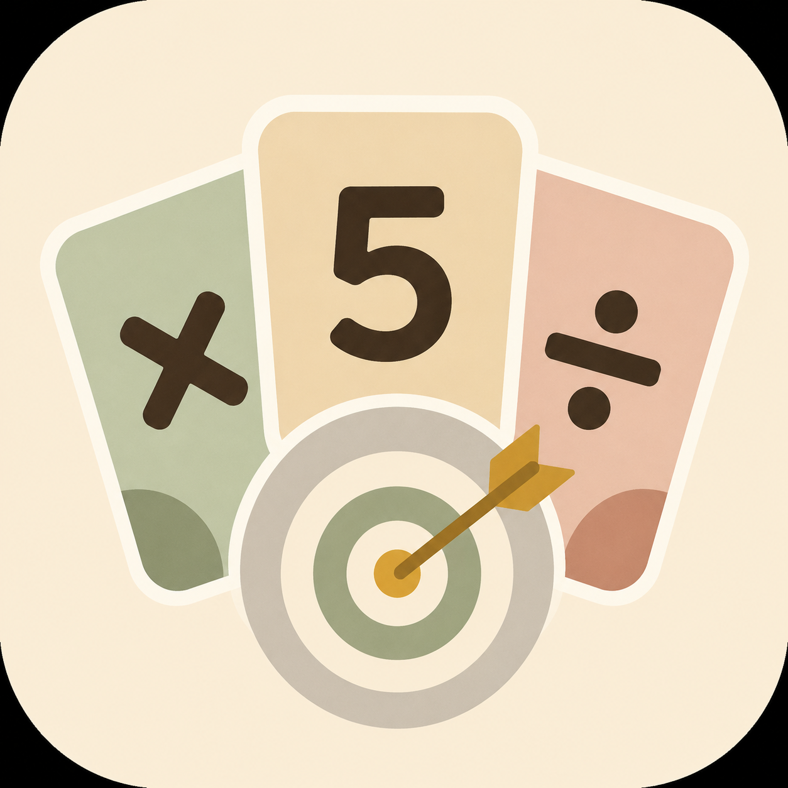

# Krypto



A fast arithmetic card game for iOS, with a daily puzzle, a rated solo mode, and real-time ranked 1v1 multiplayer.

**[Download on the App Store](https://apps.apple.com/us/app/krypto-card-game/id6794679898)** · [kryptopuzzle.com](https://kryptopuzzle.com)

You are dealt five cards and a target. Combine all five with `+ − × ÷`, each card used exactly once, to hit the target. First to a valid solution wins.

## What's in the app

- **Daily puzzle** — one shared hand per day, server-generated, with global solve stats and a personal streak.
- **Solo (beat the clock)** — a performance-based solo rating that updates after each timed solve.
- **Ranked 1v1** — live matchmaking, Elo-style rating, five placement matches, and Bronze → Grandmaster tiers with a demotion margin.
- **Casual multiplayer** — challenge friends directly or pass one phone back and forth.
- **Server-side bots** — when the queue is thin, a bot with a tuned solve-time distribution steps in so nobody waits.
- **Opponent presence** — activity dot and progress pips show what the other player is doing mid-match.
- **Social** — friends, challenges, rematches, referral codes, push notifications.
- **Stats** — solve history, rating charts, and a replay of each solve.
- **Accounts** — email and Google sign-in, username claims, full account deletion with server-side cleanup.

## Architecture

```
Krypto/          iOS client · Swift / SwiftUI (54 files, ~15k lines)
android/         Android client · Kotlin / Jetpack Compose (daily + solo + auth, in progress)
functions/src/   Firebase Cloud Functions · TypeScript
firestore.rules  Firestore security rules
firestore.indexes.json
remoteconfig.template.json   22 feature flags and tuning knobs
legal/           Privacy policy, terms, support page
```

**Game engine in three languages.** `Krypto/GameEngine.swift`, `functions/src/krypto.ts`, and `android/.../KryptoEngine.kt` implement the same deal, canonical puzzle ID, solvability check, and difficulty estimate so the server can validate what clients claim.

**Backend (Firebase).**
- *Firestore* holds users, ranked matches, casual rooms, the matchmaking queue, friends, referrals, and daily puzzle stats. Clients subscribe with snapshot listeners, so moves propagate in real time without a custom socket server.
- *Cloud Functions* run matchmaking (`onQueueJoin`), bot opponents, stale-queue cleanup, daily puzzle generation and publishing on a schedule, referral and friend-request fan-out, rematch handling, push notifications, and account-deletion cleanup.
- *Remote Config* gates every major feature (`multiplayer_enabled`, `ranked_bots_enabled`, `rating_tiers`, update forcing, …) so the backend can change behaviour without an App Store release.
- *Security rules* enforce per-user ownership and keep match state writable only by participants.

**Scale notes.** Daily puzzle stats are written to sharded counters rather than one hot document. Queue entries expire on a schedule so abandoned sessions don't poison matchmaking. Bot matches are force-finished if a client disappears.

## Running it yourself

The repo omits the Firebase client config files. To build against your own Firebase project:

1. Create a Firebase project with Firestore, Auth (email + Google), Cloud Functions, and Remote Config.
2. Drop `GoogleService-Info.plist` into `Krypto/` and `google-services.json` into `android/app/`.
3. iOS: `xcodegen generate`, then open `Krypto.xcodeproj` and build. `project.yml` is the source of truth.
4. Backend: `cd functions && npm install && npm run build`, then `firebase deploy`.
5. Android: `cd android && ./gradlew testDebugUnitTest assembleDebug` (JDK 17).

Debug env `KRYPTO_DEMO_STATS=1` opens the stats screens signed out with seeded data; `KRYPTO_DEMO_PRESENCE=1` runs a scripted opponent inside the ranked match screen.

## Status

Live on the App Store since July 2026. Android port shares the backend and is being brought to feature parity.
